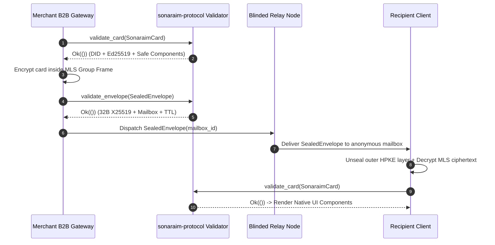
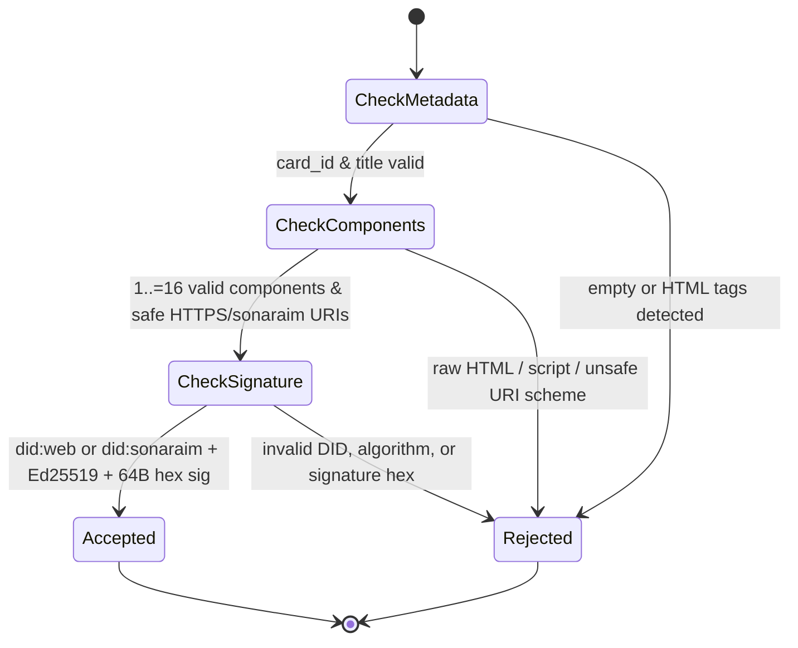

# Protocol Diagrams — sonaraim-protocol

> Mermaid sequence, state, and class diagrams for the Sonaraim protocol layer.

## 1. Sealed Sender Delivery & Card Verification Sequence

## 2. Card Validation State Machine

